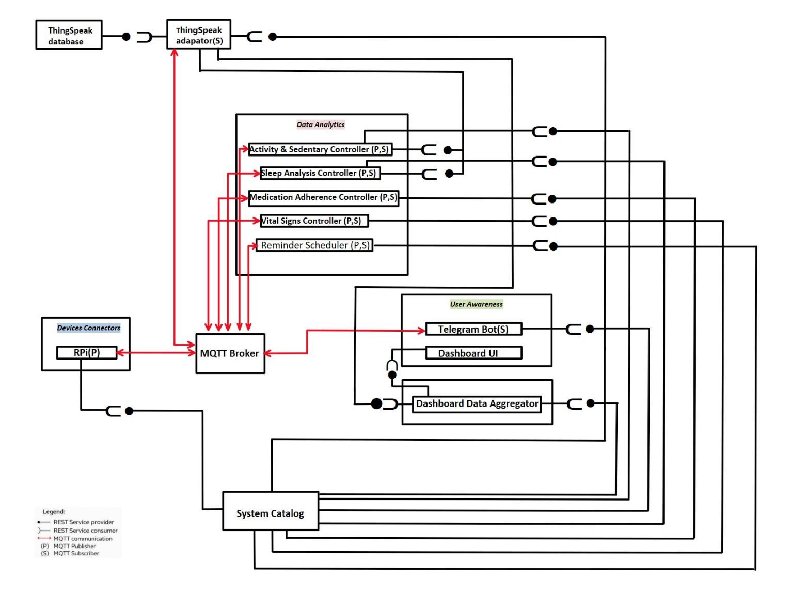

# Smart Rehabilitation IoT Platform

**An IoT-based rehabilitation monitoring prototype that combines simulated sensor data, real-time communication, activity analysis, and automated notifications.**

**Project areas:** Internet of Things · Smart Healthcare · Python · Data Analytics · Machine Learning

## Overview

The **Smart Rehabilitation IoT Platform** explores how connected devices and independent software services can support at-home rehabilitation monitoring. It brings together simulated health and activity readings, automated analysis, a web dashboard, and optional notifications in a modular system.

The prototype uses **simulated sensor data**, rather than physical patient measurements.

## Key Features

- **Health monitoring:** Processes temperature readings and generates summaries and threshold-based alerts.
- **Activity analysis:** Tracks movement, detects prolonged inactivity, and adapts monitoring thresholds using K-means-based activity profiles.
- **Sleep monitoring:** Summarizes nighttime activity, sleep duration, and restlessness.
- **Medication tracking:** Compares simulated pillbox events with medication schedules and generates reminders.
- **Web dashboard:** Presents monitoring information and supports configurable schedules and settings.
- **Notifications and storage:** Uses MQTT for real-time messaging, retains historical readings locally, and supports optional Telegram alerts and ThingSpeak uploads.

### Machine Learning: Adaptive Activity Profiling

The activity controller implements a **custom one-dimensional K-means algorithm** to group historical activity data into **Active**, **Average**, and **Weak** profiles. These profiles help adjust inactivity thresholds and alert timing based on observed movement patterns. When there is insufficient historical data, the system uses its default thresholds.

## System Architecture



*Architecture diagram from the original team proposal.*

The platform connects its components through **MQTT messages** and **REST APIs**:

1. A Raspberry Pi-oriented connector publishes simulated sensor readings to a **Mosquitto MQTT broker**.
2. Python monitoring controllers process temperature, activity, sleep, and medication events, producing summaries and alerts.
3. The **System Catalog** manages service registration and shared settings, while the data adapter stores time-series readings locally and can forward them to ThingSpeak.
4. A browser-based **dashboard** displays processed information; an optional **Telegram bot** delivers notifications and status reports.

## Technology Stack

| Area | Technologies |
| --- | --- |
| Programming | Python |
| IoT communication | MQTT, Mosquitto, `paho-mqtt` |
| Backend and integration | REST APIs, Python HTTP servers |
| Data analytics and ML | Moving averages, rolling windows, thresholds, 1D K-means |
| Frontend | HTML, CSS, JavaScript |
| Data storage | Local JSONL time series, optional ThingSpeak |
| Notifications | Telegram Bot API, `requests` |

## Getting Started

**Requirements:** Python 3, `pip`, a running MQTT broker (such as Mosquitto on `localhost:1883`), and a web browser.

**1. Install dependencies** from the project root:

```bash
python3 -m venv .venv
source .venv/bin/activate
pip install -r requirements.txt
```

On Windows PowerShell, activate the environment with `.venv\Scripts\Activate.ps1` instead.

**2. Start Mosquitto**, then launch the local demo on macOS or Linux:

```bash
bash scripts/run_pi_demo.sh
```

For Windows, use the included `scripts/run_local_demo.ps1` launcher. The demo starts the catalog, adapter, monitoring services, dashboard, and simulated sensor connector.

**3. Open the dashboard** at:

```text
http://127.0.0.1:8093
```

**Optional integrations:** Configure `configs/telegram.json` using `configs/telegram.json.example` to enable Telegram notifications. ThingSpeak uploading can be enabled through `configs/thingspeak.json`. Keep API keys and bot tokens out of Git.

To check the System Catalog API independently, run:

```bash
python3 scripts/smoke_test.py
```

More setup details are available in [`docs/LOCAL_DEMO_GUIDE.md`](docs/LOCAL_DEMO_GUIDE.md).

## Project Structure

```text
Smart-Rehabilitation-IoT/
├── catalog/         # Service registry and shared configuration
├── connector/       # Simulated Raspberry Pi sensor data
├── control/         # Monitoring and reminder controllers
├── adapter/         # Historical storage and ThingSpeak integration
├── dashboard/       # Dashboard backend and interface
├── notification/    # Telegram bot integration
├── common/          # Shared utilities
├── configs/         # Service configuration
├── scripts/         # Demo launchers and smoke test
├── docs/            # Architecture and setup documentation
├── requirements.txt
└── README.md
```

## Project Team

Developed collaboratively by **Tala Hareb, Xiang Li, Shiyun Tang, and Xianlu Feng**.

## Key Concepts

- **Internet of Things:** Collecting and exchanging simulated sensor data through MQTT messaging.
- **Microservices architecture:** Organizing monitoring, storage, notifications, and configuration into independent Python services.
- **Machine learning:** Applying K-means clustering to adapt activity monitoring thresholds.
- **Data analytics:** Analyzing time-series data to generate summaries, reminders, and alerts.
- **System integration:** Connecting MQTT services, REST APIs, data storage, and a web dashboard.
